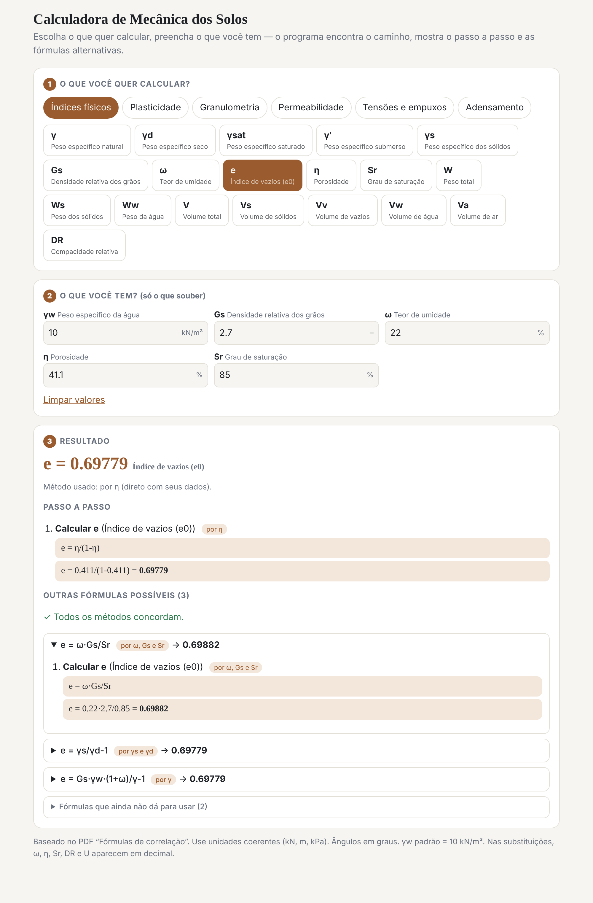
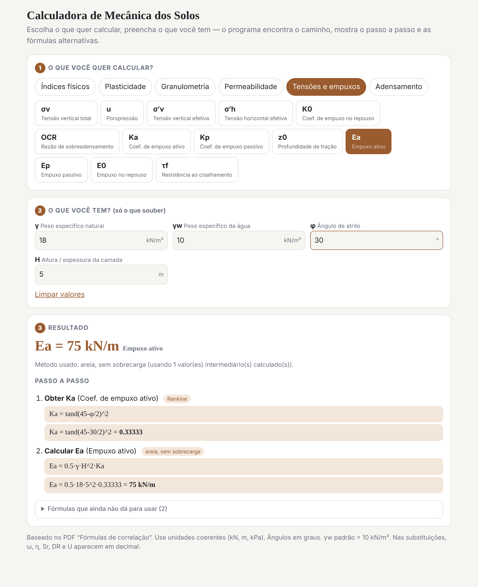

# Calculadora de Mecânica dos Solos

App de engenharia geotécnica para **índices físicos, plasticidade, granulometria, permeabilidade, tensões/empuxos e adensamento**, baseado na tabela "Fórmulas de correlação para Índices Físicos".

É um único arquivo HTML: abra com duplo clique no navegador, sem instalar nada e sem internet.

**Online:** https://victortlacerda.github.io/calculadora-indices-fisicos/



## Como funciona

1. **Escolha o que quer calcular**, por exemplo e, γsat, Ka, Ea, S, Cv.
2. **Informe o que você tem**, só os dados que souber. O app mostra apenas os campos relacionados ao cálculo.
3. **Veja o resultado**, com o passo a passo, a substituição numérica e as fórmulas alternativas.

Quando faltam dados, o app mostra quais fórmulas poderiam ser usadas e o que falta preencher em cada uma.

## Destaques

- **Encadeia fórmulas sozinho.** Se você não tem Ka, ele calcula Ka a partir de φ e segue para o empuxo.
- **Passo a passo completo.** Cada etapa mostra a fórmula e a substituição com os seus números.
- **Fórmulas alternativas.** Compara os métodos possíveis (por exemplo, e por η, por ω·Gs/Sr ou por γs/γd) e avisa se os resultados divergem.
- **Mais de 100 correlações** das tabelas do PDF, em seis grupos.
- **Funciona offline**, em celular ou computador, com tema claro e escuro automático.

## Exemplos

### Empuxo ativo (Rankine)

Com γ, H e φ, o app calcula Ka e depois Ea, mostrando as duas etapas. As fórmulas com sobrecarga e para solo coesivo aparecem como "ainda não dá para usar", com o dado que falta.



### Recalque por adensamento


## Assuntos cobertos

| Grupo | Exemplos |
|---|---|
| Índices físicos | e, η, Sr, ω, γ, γd, γsat, γ′, γs, Gs, DR |
| Plasticidade | IP, IL, IA, LL, LP |
| Granulometria | Cu, Cc, D10 |
| Permeabilidade | Darcy, Hazen, permeâmetros de carga constante e variável |
| Tensões e empuxos | σv, σ′v, u, K0, Ka, Kp, Ea, Ep, E0, τf |
| Adensamento | Cc, Cs, mv, av, recalque, Tv, U, Cv (Taylor e Casagrande) |

## Convenções

- Unidades coerentes (kN, m, kPa). Ângulos em graus.
- γw padrão = 10 kN/m³ (editável).
- ω, η, Sr, DR e U são digitados em % e tratados internamente como decimal.

## Para desenvolvedores

Cada fórmula é uma linha na constante `R` do `index.html`, no formato:

```
alvo|expressão|descrição|condição (opcional)
```

Exemplo: `gd|gs/(1+e)|por γs e e`

Variáveis novas entram no objeto `C` (símbolo, nome, unidade; 4º item `1` se for percentual). O motor usa as variáveis da expressão para decidir sozinho quando a fórmula é aplicável.

Os prints em `docs/screenshots/` mostram só os campos preenchidos, para ficarem compactos. O app real mostra todos os campos relacionados.

## Aviso

Ferramenta de apoio ao estudo e ao pré-dimensionamento. Confira os resultados e a aplicabilidade de cada correlação empírica antes de usar em projeto.
